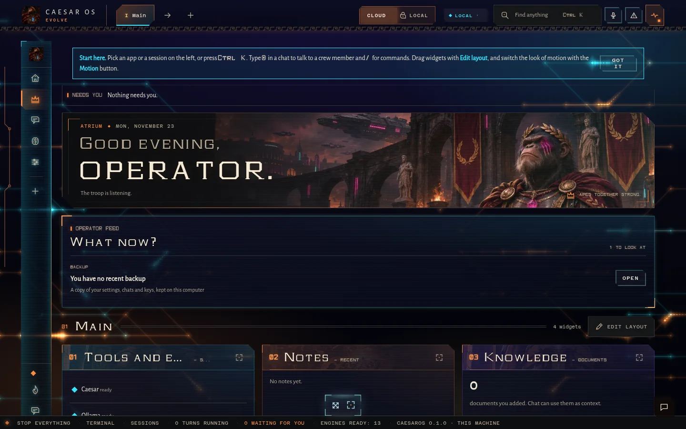

# csr0S — CaesarOS

> **Apes together strong. Caesar, Slayer of the Digital Gods.**

**The AI workspace that runs on your machine, not in someone else's cloud.**
A crew of agents you can talk to, a Brain that actually remembers, a Board that tracks what happens, and real computer control — all local, all yours, zero subscription.



---

## Stop renting your intelligence.

The big AI apps are brilliant at answering. They are also just **sessions** — throwaway conversations with no memory, no team, no access to your machine, and a monthly bill for a text box.

CaesarOS is the turn. Your agents live **on your hardware**, remember **everything you decided**, work **as a crew**, and can **act** on your computer — with you in control of every step.

Everything is plug-and-play with what you already run. Hermes, command-line coding tools, or a local model — every agent profile you have becomes a **crew member** in minutes.

---

## The crew, not a chatbot

A whole slate of named agents, each with its own role, memory and skills — talking to you, handing work to each other, and reporting back in their own voice. One chat, a whole operation.

## The Brain that never forgets

Shared, cross-session memory. Facts and decisions you make are **written down and actually used** — not lost when the context window closes. Ask the crew what you already decided; it answers from what it keeps.

## The Board of what's real

Plans, goals, running work, approvals, things waiting on you. The live state of your operation — not a chat log.

## Hands on your machine

With your explicit approval, the crew can read your screen, control your windows and keyboard, run your terminal, and get things done — not just talk about them.

## Your machine. Your data. Your rules.

Everything runs locally. Works offline. No account, no tracking, no vendor lock-in. Your notes are plain Markdown; your chats and settings are yours on disk. What you build, you own.

---

## Installation

Ships for **Linux** today. Windows, macOS, and Android are coming — star the repo to get the installer the day it lands.

```bash
# One line. Local-first. No cloud, no account.
curl -fsSL https://csr0s.app/install.sh | bash
```

```bash
# Start the core (binds 127.0.0.1 by default)
caesarcore
```

The first run walks you through picking an engine (Ollama, OpenRouter, or a local model), pairs your agent profiles, and opens the Atrium. The printed address is yours — on your network, on your disk.

**Windows · macOS · Android** — *coming soon.* Join the waitlist at https://csr0s.app.

---

## Why CaesarOS, not other AI apps

The big AI apps are fine as text boxes, but calling out any vendor misses the point. The other apps are just **sessions** — throwaway conversations with no memory, no team, no access to your machine, and a monthly bill.

| CaesarOS | Other AI apps |
|---|---|
| A crew of named agents with memory and skills | One chatbot, one session |
| Brain: remembers decisions across sessions | Forgets when the window closes |
| Works on your computer, with your approval | Can't touch your machine |
| Local-first, works offline, no subscription | Cloud, subscription, your data on their servers |
| Plan on a Board, handoff, approvals | Chat, then you do the rest |

Stop renting intelligence. **Own it.**

---

## Project status

**Alpha 0.01.** This is a working build — the core is functional and tested, the Atrium shell is live, and the crew, Brain, Board and computer control are all real. Windows/macOS/Android and the full installer are on the way.

## How it fits together

- `core/` is the server: data folder, auth, event stream, module registry, chat, engines, notes,
  Board, mail, sync, approvals, terminal and computer control. Each concern is one file.
- `web/atrium/` is the shell the person sees, in plain JavaScript and CSS with no framework. It
  talks to the core's API only.
- `plugins/` are modules with their own routes and store, registered through the module interface.
- `skills/` are agent skills as markdown files, ready to be used by the crew.
- `src-tauri/` is the native desktop window around the same pages.

`packs/` holds fonts, icons and themes, each with a manifest. `tools/` holds the scripts, including
the agent layer and the leak check.

## For agents

An attached coding agent can read the Brain and the Board through MCP, and nothing else. The server
is `tools/caesar-layer-mcp.ts` and speaks MCP over standard input and output (`caesar_start`,
`caesar_recent`, `caesar_search`, `caesar_memory`, `caesar_todo`, `caesar_dag`, `caesar_status`).
It reads only what the owner shared, never edits the owner's notes, and can close only cards it
created and only with evidence.

## Privacy and safety

- The core binds to loopback and serves only its own pages. It refuses API writes from another site
  and rejects an unknown hostname.
- No hidden egress. Outbound requests go only to addresses you added (model servers, paired devices,
  gateways), and only when a feature needs them.
- Approvals gate anything outward or irreversible. Stop everything halts every running turn.
- Terminal and computer control are separate switches. Computer control arms for at most 15
  minutes and logs every action.
- Secrets such as API keys and device tokens are kept apart from settings and never returned by the
  API.

## Development

```sh
bun test tests        # the test suite, under tests/
bun run typecheck     # TypeScript, no emit
bun tools/leak-check.ts   # refuses personal data, paths, secrets and private addresses
```

- Run `bun test` and `bun run typecheck` before a push.
- The leak check runs on commit once `bun tools/install-hooks.sh` is installed. It exits 1 when
  something leaks.
- Commit explicit paths, never `git add -A`.

## Acknowledgements

- [Hermes Agent](https://github.com/NousResearch/hermes-agent) by Nous Research: the default crew
  runtime.
- [xterm.js](https://github.com/xtermjs/xterm.js): the terminal.
- [Hono](https://github.com/honojs/hono): the server framework.
- [imapflow](https://github.com/postalsys/imapflow), [mailparser](https://github.com/nodemailer/mailparser)
  and [nodemailer](https://github.com/nodemailer/nodemailer): mail.
- The SIL Open Font License fonts in `packs/fonts/`
  ([OFL](https://openfontlicense.org)).
- [Oh My Hermes](https://github.com/rlaope/oh-my-hermes) by rlaope: ideas for the agent layer,
  rewritten as our own code.

## License

MIT — see [LICENSE](LICENSE). Third-party components and their licences are in
[THIRD-PARTY-NOTICES.md](THIRD-PARTY-NOTICES.md).
