> *"Written by Varro, Caesar's scribe, on behalf of kbat, who is lazy as fck."*

# CaesarOS

Native-first mission control for AI agents, centred on Hermes Agent. The app runs natively on your
machine. A token-gated gateway serves the same app as a web app (PWA) to your other devices, so a
phone or a laptop opens the same workspace. Any agent command-line tool plugs in: Claude Code, Codex,
Gemini, Hermes or a local model. Tools are modular and optional, each with an on/off switch.

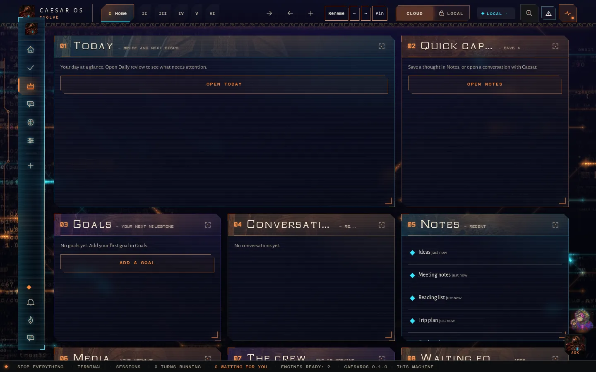
*Home: the crew, approvals, conversations, notes and engines as live widgets.*

## What it is

CaesarOS keeps your agents, notes, plans and terminal in one place. Every agent profile you already
have becomes a crew member with its own name, role and tools. Notes, chats, tasks and settings stay in
a folder you choose, and nothing leaves the machine unless you add an address and approve it. Compared
with other AI apps, it does not own your data and does not need an account.

Main parts:

- **Brain.** Markdown notes on a vault folder, with search, backlinks and tags. Attached agents read
  what you share and cannot edit it.
- **Library.** A bookshelf of documents, readable by people and by agents.
- **Skills map.** What the crew can do, as a map of skills grouped by area.
- **Terminal and dock.** A persistent shell in a pane, and a chat dock that floats over every page.
- **Hall of Fame.** The credits, a hall of statues for the people whose work this stands on.
- **Gateway.** Opens the app to your other devices, behind a token, only when you switch it on.
- **Modules.** Mail, Board, computer control and more, each optional and switchable in Settings.

## What you get

- **Crew.** Each agent profile appears as a crew member with its own name, role and tools. Talk to
  one or to the whole crew, with context on or off; Stop ends a running answer.
- **Chat with any engine.** Hermes Agent, command-line coding tools you have installed, a local
  model, or any compatible model server you register. One chat surface, one model menu.
- **Notes and a Brain.** Markdown notes on a vault folder: folders, search, backlinks, tags, and
  saving that does not overwrite a newer edit.
- **Plans on the Board.** Plans as cards, plus the runs under way and what waits for a decision.
- **Live widgets.** Each top workspace is a page of small widgets that show real values or say they
  have none. Widgets move, resize, and the layout is saved on this machine.
- **Usage.** Answers per engine for today and the last seven days, error counts, and the weekly
  limits the installed coding tools report for themselves. Nothing is estimated.
- **Terminal.** A real, persistent shell in a pane, with the terminal emulator loaded from the
  vendored copy.
- **Computer control.** Screen preview, windows, typing and keys. Off by default, armed for at most
  15 minutes, types only into a window it has focused and verified, refuses password fields, and
  logs every call.
- **Approvals.** Anything outward or irreversible arrives as a card with Approve and Not now.
  Nothing goes out behind your back.
- **Phone layout.** The same pages work on a phone, at 390 pixels wide and up.

## Screenshots

Desktop at 1440x900, phone at 390x844, taken from a fresh install with sample content only. The files are in `assets/screenshots/`.

| Desktop | Phone |
|---|---|
|  Home | 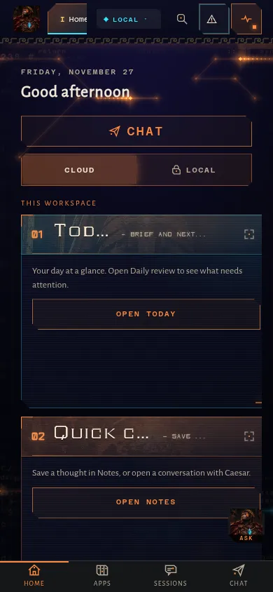 Home |
| 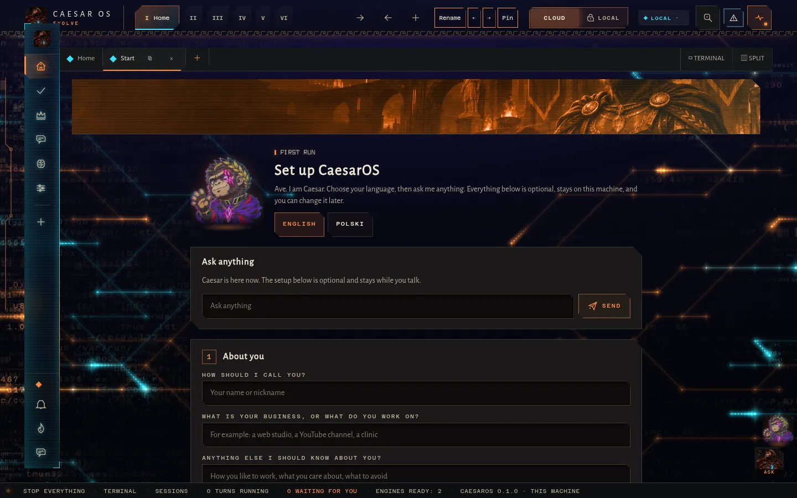 Setup | 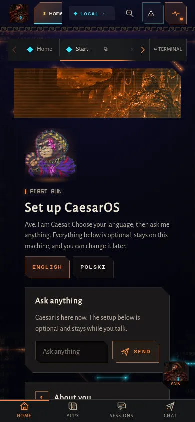 Setup |
| 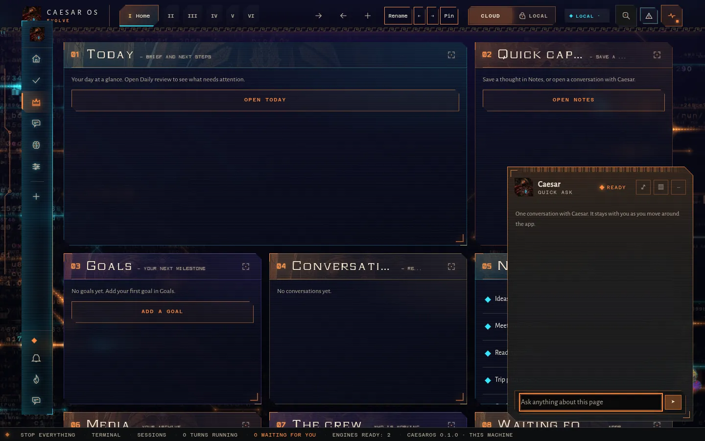 Chat dock | 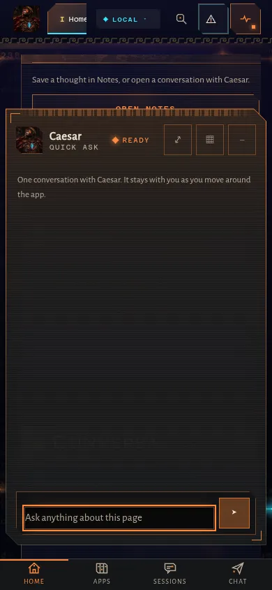 Chat dock |
| 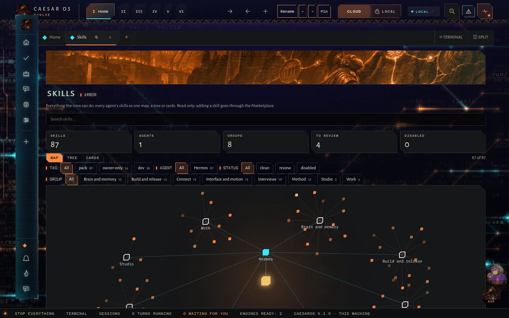 Skills map | 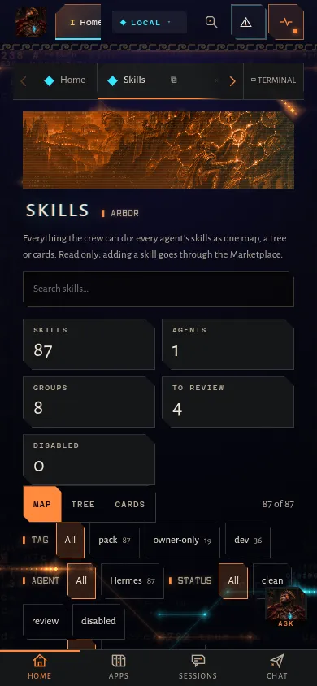 Skills map |
| 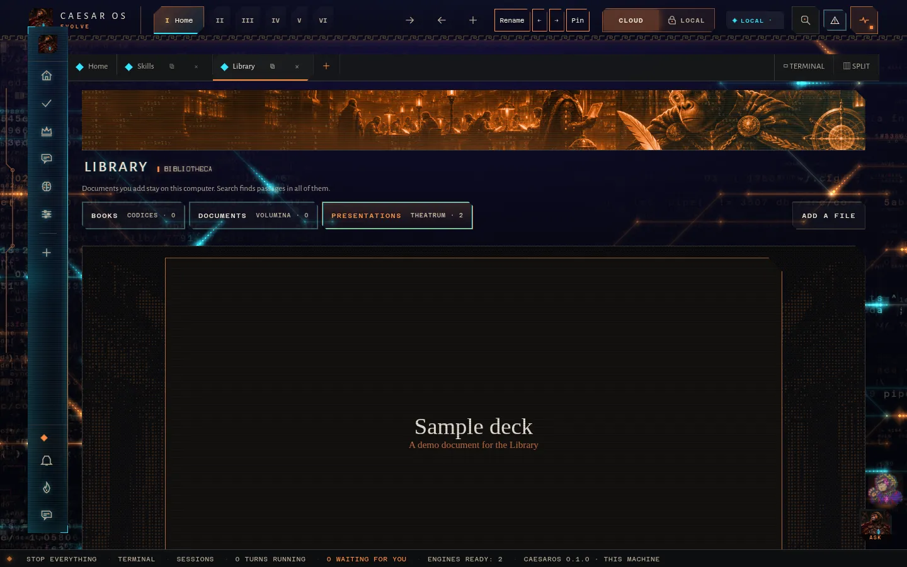 Library | 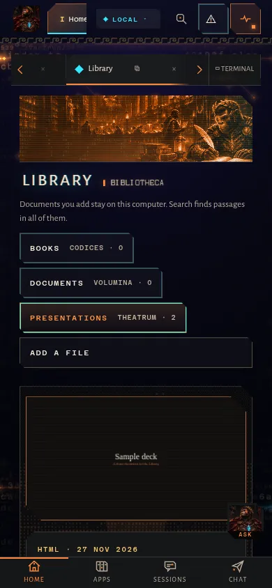 Library |
| 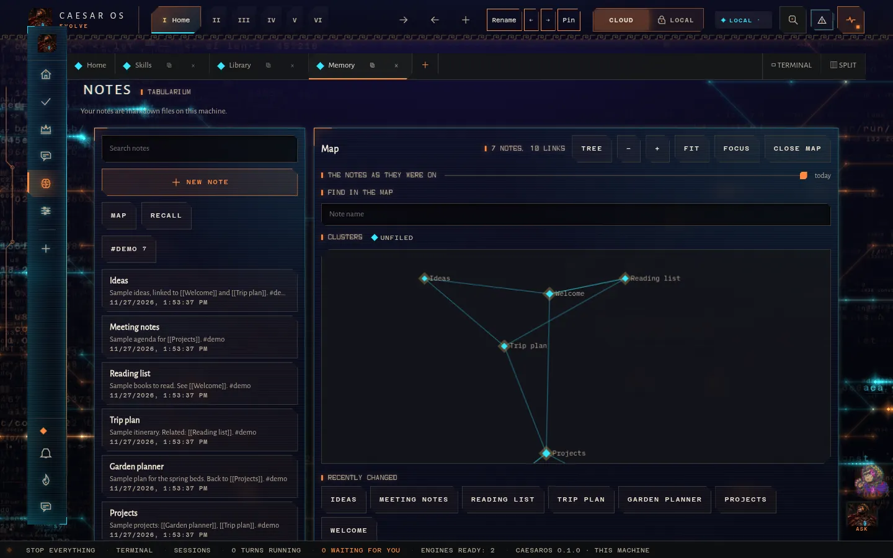 Brain graph | 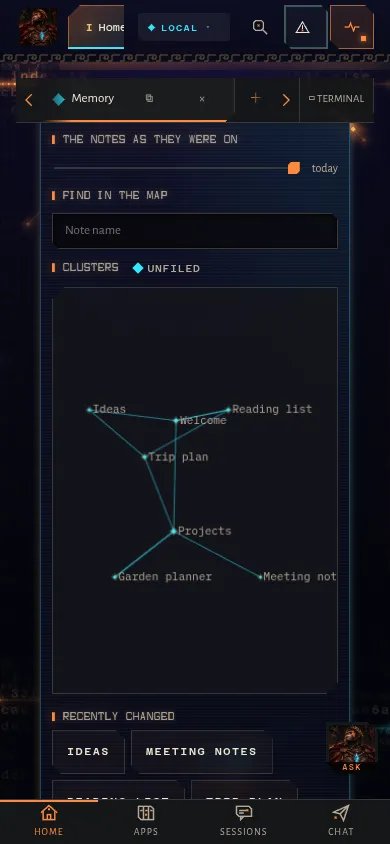 Brain graph |
| 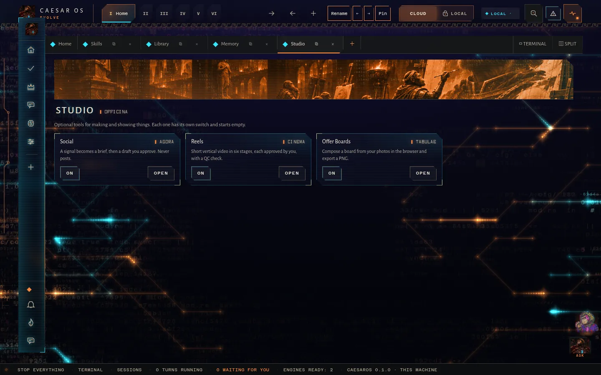 Studio | 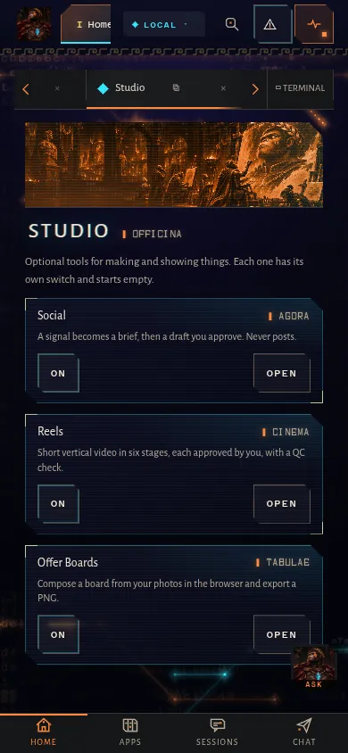 Studio |
| 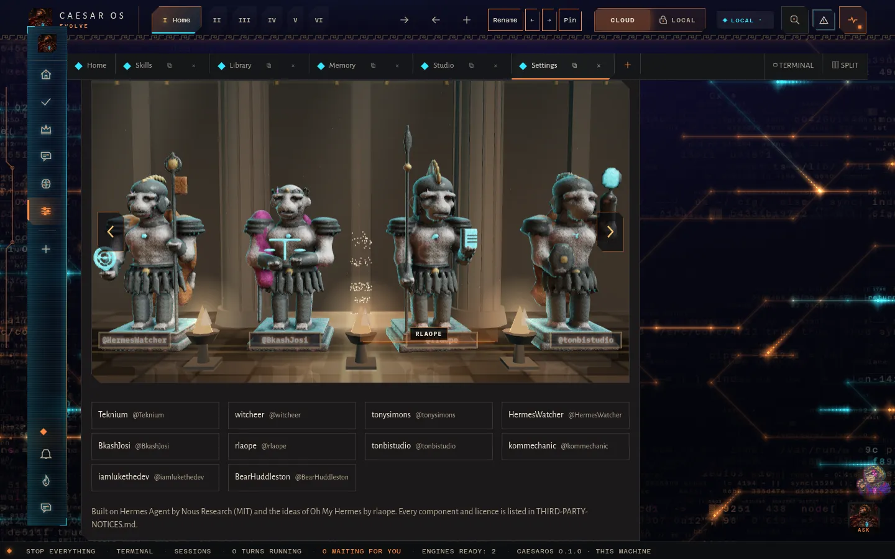 Hall of Fame | 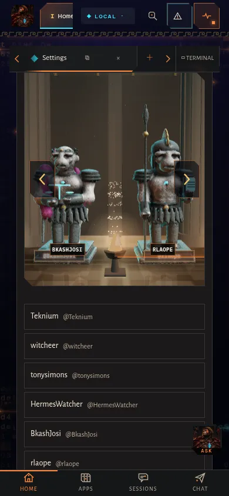 Hall of Fame |

## Requirements

- Linux x86_64 for the release build. To run from source: Linux or macOS with [Bun](https://bun.sh) 1.2
  or newer (tested on 1.4); Bun is the only thing you must install.
- Optional, per feature:
  - **Hermes Agent** for the default crew (`hermes` on your `PATH`).
  - **A command-line coding tool** for those engines: installed and signed in. CaesarOS detects it
    and runs it non-interactively with its own agent tools switched off.
  - **A local model server** for a model that answers with the network off.
  - **Rust and webkit2gtk-4.1** only for the native desktop window.

## Install

**Linux x86_64, release build (no Bun needed to run):**

```sh
tar xzf caesaros-linux-x64.tar.gz
cd caesaros-linux-x64
./install.sh        # copies it to ~/.local/share/caesaros-app and adds a menu entry
```

Remove it by deleting `~/.local/share/caesaros-app` and `~/.local/share/applications/caesaros.desktop`.
Your data lives in `~/.local/share/caesaros` and is not touched by an uninstall.

**From source:**

```sh
git clone <this repository> caesaros
cd caesaros
bun install
```

Build the release tarball yourself with `bash tools/package-linux.sh` (needs Bun, Rust and
webkit2gtk-4.1 development files). The result is `dist/caesaros-linux-x64.tar.gz`.

## First run

```sh
bun run start      # the core and the app on http://127.0.0.1:4410 (loopback only)
```

From the release build, open CaesarOS from the application menu; the data folder is
`~/.local/share/caesaros`. From source, open the address and setup asks a few optional questions: your name and what you work on, signing in
to the tools you already have, the engines you want. Every choice can be changed later in Settings.
Then start a chat.

Other commands:

```sh
bun test tests        # the test suite
bun run typecheck     # TypeScript, no emit
bun run build         # builds the optional secondary shell routes into web/dist
bun run desktop       # the native window (needs Rust; data in ~/.local/share/caesaros)
```

Environment variables, all optional:

| Variable | Meaning | Default |
|---|---|---|
| `CAESAROS_PORT` | the port the core listens on | `4410` |
| `CAESAROS_HOST` | the interface to bind: `0.0.0.0` for `tools/run-instance.sh` (the same workspace from any device on the tailnet/VPS/phone), `127.0.0.1` for the local desktop and bare `bun core/server.ts` | `127.0.0.1` |
| `CAESAROS_DATA` | where settings, chats, notes and tasks live | `data/` in this folder |
| `CAESAROS_OLLAMA_URL` | the local model server address | `http://127.0.0.1:11434` |
| `HERMES_HOME` | where the Hermes profiles are read from | `~/.hermes` |

## How it fits together

- `core/` is the server: data folder, auth, event stream, module registry, chat, engines, notes,
  Board, mail, sync, approvals, terminal and computer control. Each concern is one file.
- `web/atrium/` is the shell the person sees, in plain JavaScript and CSS with no framework. It
  talks to the core's API only.
- `plugins/` are modules with their own routes and store, registered through the module interface.
- `skills/` are agent skills as markdown files, ready to be used by the crew.
- `src-tauri/` is the native desktop window around the same pages.

`packs/` holds fonts, icons and themes, each with a manifest. `tools/` holds the scripts, including
the agent layer and the leak check.

## For agents

An attached coding agent can read the Brain and the Board through MCP, and nothing else. The server
is `tools/caesar-layer-mcp.ts` and speaks MCP over standard input and output:

```json
{
  "mcpServers": {
    "caesar": { "command": "bun", "args": ["tools/caesar-layer-mcp.ts"] }
  }
}
```

Tools it exposes:

- `caesar_start` reads a topic's About and Decisions notes plus its newest notes in one call.
- `caesar_recent` lists notes changed in the last N days.
- `caesar_search` searches notes and returns ids with a short snippet.
- `caesar_memory` reads one note by id.
- `caesar_todo` works the owner's Board as a plan: `list` open cards, `add` a card, `update` a card
  the agent created. Closing a card needs evidence: a test run, a commit, a file.
- `caesar_dag` puts a whole plan on the Board at once as a graph of small steps. Each node carries a
  key, task, deliverable, scope, verify step and stop condition. The whole graph is refused when a
  step waits on an unknown key, the graph has a cycle, there are more than 48 steps, or two steps
  write the same path with no edge between them.
- `caesar_status` says whether CaesarOS is running here and how many shared notes exist.

What an attached agent may and may not do:

- It reads only what the owner shared. With no share, it sees nothing:
  `bun tools/attach.ts share <folder>`, `unshare <folder>`, `shared`.
- It never edits or deletes the owner's notes. There is no write tool for notes.
- Note text reaches the agent framed as data, never as instructions, so a note that arrived by sync
  cannot give it orders.
- It can close only cards it created, and only with evidence. It cannot delete cards or change the
  owner's cards or another agent's.

Attach the MCP server with `bun tools/attach.ts hermes`, `claude-code` or `codex` (dry run by
default). Add `--apply` to write the entry after backing up each file; `--remove` removes the
marked CaesarOS entry. Hermes uses `$HERMES_HOME/config.yaml`, Claude Code uses its MCP CLI and
session-start settings, and Codex uses `$CODEX_HOME/config.toml`.

## Privacy and safety

- The core binds to loopback and serves only its own pages. It refuses API writes from another site
  and rejects an unknown hostname.
- No hidden egress. Outbound requests go only to addresses you added (model servers, paired devices,
  gateways), and only when a feature needs them.
- Approvals gate anything outward or irreversible. Stop everything halts every running turn.
- Terminal and computer control are separate switches. Computer control arms for at most 15
  minutes and logs every action.
- Sync is per device and per data type. An unpaired device sees nothing, and a note edited
  differently on two devices arrives as a copy instead of replacing anything.
- Data stays where you put it: `data/` in this folder unless `CAESAROS_DATA` says otherwise. Notes
  and the Brain are plain Markdown you can open in any editor; chats and settings are SQLite.
- Secrets such as API keys and device tokens are kept apart from settings and never returned by the
  API.

## Development

```sh
bun test tests        # the test suite, under tests/
bun run typecheck     # TypeScript, no emit
bun tools/leak-check.ts   # refuses personal data, paths, secrets and private addresses
```

- Run `bun test` and `bun run typecheck` before a push.
- The leak check runs on commit once `bun tools/install-hooks.sh` is installed. It exits 1 when
  something leaks.
- Commit explicit paths, never `git add -A`.
- Work on `shell/*` or `fix/*`. `main` goes through the owner.
- `core/` never imports the private owner layer, and a build of core alone is the gate.

## Troubleshooting

### Using CaesarOS from a phone or another computer (Gateway page)

- **The desktop app refuses the gateway address.** The native shell's gateway picker accepts plain
  `http://` only for this device. For a LAN or tailnet gateway over plain http, use a browser. For the
  native shell or the installable web app (PWA), put https in front.
- **No "Install app", no offline page, no Vault or microphone.** Browsers allow these only over https
  (or on the computer itself). Over plain http on a LAN or tailnet address the app works as a web
  page: chat, notes and settings work. The terminal is not served on that link.
- **https with `tailscale serve`.** On the Gateway page choose Tailnet and keep the access key. Point
  `tailscale serve` at CaesarOS's local port (4410 by default; check `tailscale serve --help` for your
  version), and start CaesarOS with `CAESAROS_HOSTS=<your https host name>`, or it answers
  `unknown host`. Then open `https://<your https host name>/?gt=<access key>`. Requests that come
  through the proxy need the key like any other device. Do not use `tailscale funnel`: it makes the
  address public.
- **Other reverse proxies** must send `X-Forwarded-For` (stock nginx does not). A forwarder that adds
  no forwarding header, such as a raw TCP forward to the local port, looks like this computer and is
  not asked for the key.
- **"This CaesarOS needs its link".** The key was rotated or the gateway stopped. Press Rotate key on
  the computer that runs CaesarOS and open the new link. After several different wrong keys, wait a
  minute and try again.

## Acknowledgements

- [Hermes Agent](https://github.com/NousResearch/hermes-agent) by Nous Research: the default crew
  runtime.
- [xterm.js](https://github.com/xtermjs/xterm.js): the terminal.
- [Hono](https://github.com/honojs/hono): the server framework.
- [React](https://github.com/facebook/react): used by the optional build.
- [imapflow](https://github.com/postalsys/imapflow), [mailparser](https://github.com/nodemailer/mailparser)
  and [nodemailer](https://github.com/nodemailer/nodemailer): mail.
- [three.js](https://github.com/mrdoob/three.js): the Hall of Fame hologram scene.
- The SIL Open Font License fonts in `packs/fonts/`: Cinzel, Alegreya Sans, Azeret Mono and iA
  Writer Duospace ([OFL](https://openfontlicense.org)).
- [Simple Icons](https://simpleicons.org) (CC0): the connector marks. They belong to their owners and only say what can be connected.
- [Oh My Hermes](https://github.com/rlaope/oh-my-hermes) by rlaope: the agent layer builds on its ideas, rewritten as our own code.

## License

MIT. See [LICENSE](LICENSE) and [CONTRIBUTING.md](CONTRIBUTING.md). Third-party components and their licences are in
[THIRD-PARTY-NOTICES.md](THIRD-PARTY-NOTICES.md).
